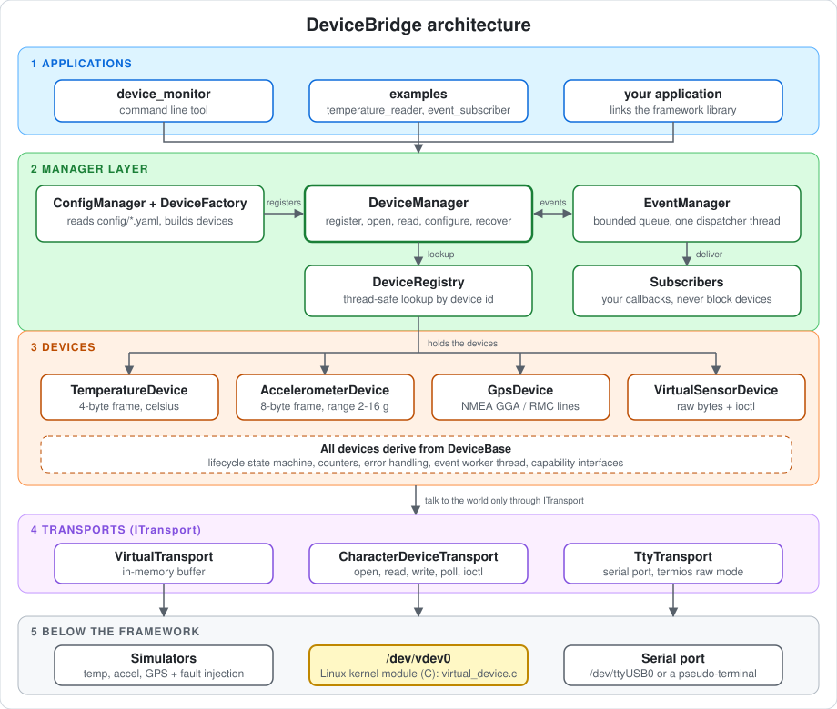

# DeviceBridge

**One interface for every device.**

DeviceBridge is a C++17 framework for Linux that manages different kinds of devices (temperature sensor, accelerometer, GPS, a generic stream device) through one small API. It comes with a C Linux kernel module (a virtual character device, `/dev/vdev0`) that the framework can talk to, a command line tool to try everything by hand, simulators so you need no hardware, and a full set of tests.



## Table of Contents

- [Introduction](#introduction)
- [Demo](#demo)
- [Architecture](#architecture)
- [File Structure](#file-structure)
- [Getting Started](#getting-started)
  - [Quick start (5 commands)](#quick-start-5-commands)
  - [Option A: Ubuntu or Debian Linux](#option-a-ubuntu-or-debian-linux)
  - [Option B: Windows with WSL2](#option-b-windows-with-wsl2)
  - [Option C: Ubuntu virtual machine](#option-c-ubuntu-virtual-machine)
  - [Build, test and run](#build-test-and-run)
  - [Kernel driver](#kernel-driver)
- [Usage](#usage)
- [Experiments and Results](#experiments-and-results)
- [Troubleshooting](#troubleshooting)
- [References](#references)

---

## Introduction

Linux devices are reached in many different ways: character device files, serial ports, ioctl calls, kernel drivers. Application code that talks to each one directly ends up full of device-specific details. DeviceBridge puts one clean layer in between.

**What it does**

- One API (`DeviceManager`) to register, open, read, configure, monitor and close any device.
- Small capability interfaces (measurement, stream read, stream write, configure, events, reset, diagnostics) so a device only offers what it really supports.
- A device lifecycle state machine: Discovered, Registered, Ready, Open, Error, Recovering, Closing, Closed. Wrong transitions are rejected.
- A bounded event system. A slow subscriber can never block a device. Overflow events are dropped and counted.
- Automatic recovery of failed devices with limited retries and a delay between them.
- Thread-safe registry and one lock per device.
- Three transports: in-memory virtual device (for simulators), character device (`open/read/write/poll/ioctl`), and serial port (`termios`).
- Simulators with fault injection (disconnect, malformed data, delays, lost GPS fix), so every failure path can be tested without hardware.
- A Linux kernel character driver in C: 4096-byte ring buffer, mutex, wait queues, blocking and non-blocking I/O, `poll`, a delayed-work sample generator, 6 ioctl commands, safe user-memory copies.
- Errors are returned as values (`Status`, `Result<T>`), not exceptions.

**Tested on:** Ubuntu 26.04 under WSL2, kernel 6.18.33.2, GCC 15.2. Other setups below are standard steps but were not run by the author, and the text says so where it matters.

## Demo

A real session with the command line tool (`device_monitor`). It lists the devices, reads three of them, changes a setting, unplugs a device, shows the error, then recovers it. Lines starting with `>` are what you type; the tool itself prints no prompt.

```
$ ./build/bin/device_monitor
device_monitor ready, type 'help' for commands
> list
accel-virtual-01  type=accelerometer  transport=virtual  state=Ready
gps-virtual-01  type=gps  transport=virtual  state=Ready
temp-virtual-01  type=temperature  transport=virtual  state=Ready
test-virtual-01  type=virtual  transport=virtual  state=Ready
> open temp-virtual-01
ok
> read temp-virtual-01
temperature: temperature=25.0000 (celsius) valid
> open accel-virtual-01
ok
> set accel-virtual-01 range_g 8
ok
> read accel-virtual-01
accelerometer: x=0.0000 y=0.2500 z=1.0000 (g) valid
> open gps-virtual-01
ok
> read gps-virtual-01
gps: latitude=12.9716 longitude=77.5946 altitude=920.0000 (deg,m,m/s) valid
> inject temp-virtual-01 disconnect
ok
> read temp-virtual-01
error: Disconnected: virtual device disconnected
> status temp-virtual-01
temp-virtual-01 state=Error
last error: Disconnected: virtual device disconnected
> inject temp-virtual-01 reconnect
ok
> recover temp-virtual-01
ok
> open temp-virtual-01
ok
> read temp-virtual-01
temperature: temperature=25.8900 (celsius) valid
```

The same flow is in a ready-made script, so you can replay it:

```
./build/bin/device_monitor --script examples/device_monitor/demo.txt --log info
```

## Architecture

The framework has five layers. Each layer only talks to the one directly below it.

| Layer | Parts | Job |
|---|---|---|
| 1. Applications | `device_monitor`, the examples, your own program | Use the framework through one API |
| 2. Manager | `DeviceManager`, `DeviceRegistry`, `EventManager`, `ConfigManager` + `DeviceFactory` | Register devices, look them up safely, deliver events, build devices from a config file |
| 3. Devices | `TemperatureDevice`, `AccelerometerDevice`, `GpsDevice`, `VirtualSensorDevice`, all built on `DeviceBase` | Parse device data, keep the lifecycle state, count operations, recover from errors |
| 4. Transports | `VirtualTransport`, `CharacterDeviceTransport`, `TtyTransport` (all `ITransport`) | Move bytes. A device never knows which transport it is using |
| 5. Below the framework | Simulators, the `/dev/vdev0` kernel module, a serial port | The data source |

The same diagram as plain text:

```
  +--------------------+     +--------------------+     +--------------------+
  |   device_monitor   |     |      examples      |     |  your application  |
  |       (CLI)        |     |                    |     |                    |
  +----------+---------+     +----------+---------+     +----------+---------+
             |                          |                          |
             |                          |                          |
             +--------------------------+--------------------------+
                                        |
                                        v
  +--------------------+     +--------------------+     +--------------------+
  |  ConfigManager +   |     |   DeviceManager    |     |    EventManager    |
  |   DeviceFactory    |---->|  register, open,   |<--->|   bounded queue,   |
  |  (config/*.yaml)   |     |  read, configure,  |     |   one dispatcher   |
  |                    |     |      recover       |     |       thread       |
  +--------------------+     +----------+---------+     +----------+---------+
                                        | lookup                   | events
                                        v                          v
                             +--------------------+     +--------------------+
                             |   DeviceRegistry   |     |    subscribers     |
                             | thread-safe lookup |     |  (your callbacks)  |
                             |    by device id    |     |                    |
                             +----------+---------+     +--------------------+
                                        |
                                        |
           +-------------------+--------+----------+-------------------+
           v                   v                   v                   v
  +----------------+  +----------------+  +----------------+  +----------------+
  |  Temperature   |  | Accelerometer  |  |      Gps       |  | VirtualSensor  |
  |     Device     |  |     Device     |  |     Device     |  |     Device     |
  +----------------+  +----------------+  +----------------+  +----------------+
           |                   |                   |                   |
           +-------------------+--------+----------+-------------------+
                                        | ITransport
                                        |
             +--------------------------+--------------------------+
             v                          v                          v
  +--------------------+     +--------------------+     +--------------------+
  |  VirtualTransport  |     |  CharacterDevice   |     |    TtyTransport    |
  |    (in memory)     |     |     Transport      |     | (serial, termios)  |
  |                    |     |   (poll, ioctl)    |     |                    |
  +----------+---------+     +----------+---------+     +----------+---------+
             |                          |                          |
             v                          v                          v
  +--------------------+     +--------------------+     +--------------------+
  |     simulators     |     |     /dev/vdev0     |     |    serial port     |
  | temp / accel / GPS |     |Linux kernel module |     | /dev/ttyUSB0 or a  |
  | + fault injection  |     |  virtual_device.c  |     |  pseudo-terminal   |
  +--------------------+     +--------------------+     +--------------------+
```

All four device classes derive from `DeviceBase`, which provides the lifecycle state machine, the counters, error handling and the event worker thread.

**How one read flows through it:** your code calls `DeviceManager::readMeasurement(id)`. The manager finds the device in the registry, checks that it supports measuring, and calls it. The device takes its own lock, reads from its `ITransport`, validates the data (sync byte and checksum for the temperature and accelerometer frames, NMEA sentence checks for GPS), converts it into a `Measurement`, and updates its counters. If anything fails, the device moves to the Error state, publishes an event, and the manager can `recover` it later.

Design decisions, with the alternatives that were rejected, are in [docs/decisions/0001-design-decisions.md](docs/decisions/0001-design-decisions.md).

## File Structure

```
DeviceBridge/
|-- include/               public headers
|   |-- core/              errors, states, capabilities, DeviceBase
|   |-- manager/           DeviceRegistry, DeviceManager
|   |-- events/            DeviceEvent, EventManager
|   |-- transport/         ITransport, Virtual, CharacterDevice, Tty
|   |-- devices/           device classes, frame and NMEA parsers
|   |-- simulator/         simulators with fault injection
|   |-- config/            ConfigManager, DeviceFactory
|   |-- util/              logger, helpers
|   `-- cli/               command processor
|-- src/                   implementation, same layout (src/cli/main.cpp = device_monitor)
|-- kernel/virtual_device/ C kernel module and the ioctl header shared with C++
|-- tests/                 unit, integration, concurrency, failure_injection, driver
|-- benchmarks/            benchmark.cpp
|-- examples/              temperature_reader, event_subscriber, char_device_client, device_monitor/demo.txt
|-- assets/                architecture.svg (the diagram in this README)
|-- config/                virtual_devices.yaml
|-- scripts/               setup, run tests, build and load the driver
|-- Makefile               main build (tested)
`-- CMakeLists.txt         alternative build (not run)
```

Documents in [docs/](docs/):

| Document | What it is |
|---|---|
| [IMPLEMENTATION_GUIDE.md](docs/IMPLEMENTATION_GUIDE.md) | File by file: what each file does, code snippets, why it is done that way, alternatives |
| [INTERVIEW_QUESTIONS.md](docs/INTERVIEW_QUESTIONS.md) | Interview questions and answers built from this project |
| [requirements.md](docs/requirements.md) | Every requirement mapped to code and tests |
| [architecture.md](docs/architecture.md) | Layers, ownership, thread-safety policy |
| [device-lifecycle.md](docs/device-lifecycle.md) | Device state machine |
| [transport-design.md](docs/transport-design.md) | Transport adapters |
| [event-system.md](docs/event-system.md) | Event queue, overflow policy, shutdown rules |
| [kernel-driver-design.md](docs/kernel-driver-design.md) | The C kernel module |
| [testing-strategy.md](docs/testing-strategy.md) | What is tested and how |
| [benchmarks.md](docs/benchmarks.md) | Measured numbers with the test environment |
| [hardware-setup.md](docs/hardware-setup.md) | Moving from simulators to real hardware |

## Getting Started

Pick the option that matches your computer. The framework (everything except the kernel driver) works in all three. The kernel driver needs extra steps, described in [Kernel driver](#kernel-driver).

| Your computer | Use | Framework | Kernel driver |
|---|---|---|---|
| Ubuntu or Debian Linux | Option A | Works | Easiest (install kernel headers) |
| Windows 10 or 11 | Option B (WSL2) | Works (tested) | Works (tested), but needs a 15 GB kernel build |
| Mac, or Windows without WSL | Option C (virtual machine) | Works | Works with kernel headers |

Only Ubuntu 26.04 under WSL2 was tested by the author. Other Debian-based systems should work with the same commands. Fedora, Arch and others need the equivalent packages for `g++`, `make` and `git`, and were not tested.

### Quick start (5 commands)

On a Linux shell with `git` installed:

```
git clone https://github.com/AnkitChavda023/DeviceBridge.git
cd DeviceBridge
bash scripts/setup_dev_environment.sh
make -j$(nproc) all
bash scripts/run_tests.sh build
```

The last line must be `suites passed: 13, failed: 0, skipped: 0`. Then try the demo:

```
./build/bin/device_monitor --script examples/device_monitor/demo.txt --log info
```

If you are not on Linux yet, follow Option B or C first.

### Option A: Ubuntu or Debian Linux

Use this if Linux is already installed on your computer.

1. Open a terminal.
2. Install git:
   ```
   sudo apt update
   sudo apt install -y git
   ```
3. Download the project:
   ```
   git clone https://github.com/AnkitChavda023/DeviceBridge.git
   cd DeviceBridge
   ```
4. Install the build tools. This installs `build-essential` (g++ and make), `cmake`, `gdb`, `valgrind` and the kernel headers when available:
   ```
   bash scripts/setup_dev_environment.sh
   ```
5. Continue with [Build, test and run](#build-test-and-run).

To see what the setup script found, look at its last lines. `kernel headers: found` means you can also build the driver.

### Option B: Windows with WSL2

WSL2 runs a real Linux (a small virtual machine) inside Windows. This is the setup that was tested.

1. **Install WSL2 and Ubuntu.** Open PowerShell as Administrator and run:
   ```
   wsl --install -d Ubuntu
   ```
   Restart the computer if it asks. When Ubuntu opens for the first time, choose a username and password.
2. **Check it is version 2.** In PowerShell:
   ```
   wsl -l -v
   ```
   The `VERSION` column must show `2`. If it shows `1`, run `wsl --set-version Ubuntu 2`.
3. **Open Ubuntu.** Start "Ubuntu" from the Start menu, or in PowerShell run `wsl -d Ubuntu`. Everything below is typed in this Ubuntu shell, not in PowerShell.
4. **Work in the Linux home folder, not in `/mnt/c/...`.** Builds are much faster there, and Windows line endings cannot break the scripts:
   ```
   cd ~
   sudo apt update
   sudo apt install -y git
   git clone https://github.com/AnkitChavda023/DeviceBridge.git
   cd DeviceBridge
   ```
5. **Install the tools.** WSL has no kernel headers package, so the script prints a note about it. That is normal:
   ```
   bash scripts/setup_dev_environment.sh
   ```
6. Continue with [Build, test and run](#build-test-and-run).

**Tip:** to edit the code with Visual Studio Code, install the "WSL" extension and run `code .` inside the `DeviceBridge` folder in Ubuntu.

### Option C: Ubuntu virtual machine

Use this on a Mac, on Windows without WSL, or if you want the driver to run on a normal Ubuntu kernel with kernel headers. This option was not run by the author, but every command inside the VM is the same as Option A.

1. **Install a virtualization program.** Any one of: VirtualBox (free, Windows, Linux, Intel Mac), VMware Workstation Player or Fusion, Hyper-V (Windows Pro), UTM (Apple Silicon Mac).
2. **Download Ubuntu.** Get an Ubuntu 24.04 LTS (or newer) ISO from <https://ubuntu.com/download>. Use the PC (amd64) image on Intel and AMD computers, and the ARM64 image on Apple Silicon.
3. **Create the virtual machine** with these settings:

   | Setting | Value |
   |---|---|
   | CPUs | 2 or more |
   | Memory | 4 GB or more |
   | Disk | 25 GB or more (40 GB if you want the driver and benchmarks) |
   | Network | NAT (default) |

4. **Install Ubuntu** from the ISO and restart into it.
5. **Use a disposable VM for the driver.** A bad kernel module can crash the whole VM. Take a snapshot before loading the driver, so you can roll back.
6. Open a terminal in the VM and follow [Option A](#option-a-ubuntu-or-debian-linux). In a normal Ubuntu VM the kernel headers install, so the driver can be built too.

### Build, test and run

All commands run inside the `DeviceBridge` folder.

**1. Build everything** (library, command line tool, three examples, benchmark, all tests):

```
make -j$(nproc) all
```

It takes about 10 seconds on a modern machine. Check the programs exist:

```
ls build/bin
```

You should see `benchmark`, `char_device_client`, `device_monitor`, `event_subscriber`, `temperature_reader`.

**2. Run all the tests:**

```
bash scripts/run_tests.sh build
```

Expected last line:

```
suites passed: 13, failed: 0, skipped: 0
```

Run the tests from the project folder, because some of them read `config/virtual_devices.yaml`. To run one suite and see each test name:

```
./build/tests/unit/test_parsers
./build/tests/integration/test_manager
./build/tests/concurrency/test_concurrency
./build/tests/failure_injection/test_failures
```

**3. Run the sanitizer checks** (optional, a few minutes the first time because it builds three times: normal, ThreadSanitizer for data races, AddressSanitizer plus UBSan for memory errors):

```
bash scripts/verify_all.sh
```

The last line must be `ALL CHECKS PASSED`.

**4. Run the command line tool:**

```
./build/bin/device_monitor
```

Type `help` for the commands, or paste the session from the [Demo](#demo) section. To replay a script instead of typing:

```
./build/bin/device_monitor --script examples/device_monitor/demo.txt --log info
```

**5. Run the examples:**

```
./build/bin/temperature_reader      # smallest possible use of the framework
./build/bin/event_subscriber        # streams events from two devices for two seconds
```

**6. Run the benchmark:**

```
./build/bin/benchmark --quick       # short run
./build/bin/benchmark               # full run, about 30 seconds
```

**CMake instead of Make** (not run by the author, so it may need small fixes):

```
cmake -S . -B build-cmake
cmake --build build-cmake -j
```

### Kernel driver

The driver is the C file `kernel/virtual_device/virtual_device.c`. It creates the device `/dev/vdev0`. Loading a kernel module can crash the kernel, so use a VM or WSL2 (a crash there only restarts WSL; run `wsl --shutdown` in PowerShell to recover).

The driver was built and tested on kernel **6.18.33.2** only. The code has version guards for kernel APIs that changed in 6.2, 6.4 and 6.12, so other recent kernels may work, but that has not been tested.

#### Driver on Ubuntu, Debian or a VM (Options A and C)

You need the headers for the running kernel:

```
sudo apt install -y linux-headers-$(uname -r)
ls /lib/modules/$(uname -r)/build        # must list files
```

Then:

```
make kernel                                  # builds kernel/virtual_device/virtual_device.ko
sudo bash scripts/load_virtual_driver.sh     # insmod, shows /dev/vdev0 and dmesg
make -j$(nproc) all driver-test
./build/bin/char_device_client               # reads, writes, ioctl against /dev/vdev0
bash scripts/run_driver_tests.sh             # the 19 driver tests
sudo bash scripts/unload_virtual_driver.sh   # rmmod, the node must disappear
```

What you should see:

- `ls -l /dev/vdev0` shows a character device with mode `crw-rw-rw-`.
- `dmesg | tail` shows `vdev: loaded, /dev/vdev0 major N`.
- The driver tests end with `driver: 19 passed, 0 failed`.
- After unloading, `dmesg` shows `vdev: unloaded` and `/dev/vdev0` is gone.

If `make kernel` stops with a compile error, the usual cause is a kernel API change. Check `uname -r`, read the first error line, and look at the version guards (`LINUX_VERSION_CODE`) in `virtual_device.c`.

#### Driver on WSL2 (Option B)

WSL2 has no kernel headers, and a module must be built against the exact kernel it will load into. The script below downloads Microsoft's matching kernel source once, builds it, then builds and loads the driver.

Before you start:

| Need | Amount |
|---|---|
| Free disk space in WSL | **about 20 GB** (the kernel build tree alone used 15 GB) |
| Time | 15 to 20 minutes |
| Download | about 250 MB (kernel source) |
| Internet | required |

Steps (in the Ubuntu shell, inside the `DeviceBridge` folder):

```
KVER=$(uname -r | sed 's/-microsoft.*//')
sudo mkdir -p /opt/wslk
sudo git clone --depth 1 --branch linux-msft-wsl-$KVER https://github.com/microsoft/WSL2-Linux-Kernel /opt/wslk/src
sudo bash scripts/wsl_build_and_load_driver.sh
```

What the script does, in order:

1. Installs GCC 13. The WSL kernel was built with GCC 13, and a module built with a different compiler version is refused with `disagrees about version of symbol module_layout`.
2. Rebuilds the kernel source using your running kernel's own configuration (`/proc/config.gz`).
3. Checks that three symbol checksums match a module that ships with your kernel, and stops with a clear message if they do not.
4. Builds `virtual_device.ko` and loads it with `insmod`.

It prints `DRIVER LOADED` at the end and saves everything it printed in `docs/driver_build_log.txt`. Then run the same tests as above:

```
make -j$(nproc) all driver-test
./build/bin/char_device_client
bash scripts/run_driver_tests.sh
sudo rmmod virtual_device                    # unload
```

After you restart WSL (`wsl --shutdown`), the module is gone but the kernel build is kept, so loading it again takes seconds:

```
sudo insmod kernel/virtual_device/virtual_device.ko
```

Only kernel 6.18.33.2 was tested. For another WSL kernel the `KVER` line picks the matching Microsoft tag automatically, but that was not run.

#### Use the driver from the command line tool

```
cat > /tmp/chardev.yaml <<'EOF'
devices:
  - id: kernel-vdev
    type: virtual
    transport: chardev
    path: /dev/vdev0
EOF
./build/bin/device_monitor --config /tmp/chardev.yaml
```

Then type:

```
open kernel-vdev
set kernel-vdev sample_interval_ms 100
sleep 500
read kernel-vdev
write kernel-vdev hello
readbytes kernel-vdev 20
stats kernel-vdev
close kernel-vdev
```

## Usage

### Command line options

| Option | Meaning |
|---|---|
| `--config file` | Device configuration file (default `config/virtual_devices.yaml`) |
| `--script file` | Read commands from a file instead of the keyboard |
| `--log level` | `debug`, `info`, `warn` (default), `error` or `off` |

### Commands

| Command | What it does |
|---|---|
| `list` | List registered devices with type, transport, state |
| `info <id>` | Details, capabilities, supported settings |
| `open <id>` / `close <id>` | Open or close a device |
| `read <id>` | Read one measurement |
| `readbytes <id> <n>` | Read up to n raw bytes |
| `write <id> <text>` | Write text plus a newline |
| `set <id> <key> <value>` | Change a setting, for example `set accel-virtual-01 range_g 4` |
| `get <id>` | Show current settings |
| `status <id>` / `stats <id>` | State and last error / read, write, error and byte counters |
| `start <id> <ms>` / `stop <id>` | Start or stop event streaming |
| `subscribe` / `unsubscribe` | Print events as they arrive |
| `inject <id> disconnect` / `reconnect` | Simulator: unplug or plug back |
| `inject <id> malformed <n>` | Simulator: corrupt the next n frames |
| `inject <id> delay <ms>` | Simulator: slow down every read |
| `inject <id> nofix` / `fix` | GPS simulator: lose or regain the satellite fix |
| `recover <id>` / `reset <id>` | Recover a device in the Error state / reset it |
| `unregister <id>` / `load <file>` | Remove a device / register devices from a file |
| `sleep <ms>` / `quit` | Wait (useful in scripts) / leave |

Try events by hand:

```
subscribe
open accel-virtual-01
start accel-virtual-01 200
sleep 1500
stop accel-virtual-01
unsubscribe
```

### Configuration file

`config/virtual_devices.yaml` uses a small YAML subset: a list under `devices:`, one `key: value` per line, `#` for comments.

| Key | Meaning | Default | Allowed |
|---|---|---|---|
| `id` | Unique device id | required | letters, digits, `-`, `_`, up to 64 |
| `type` | Device type | required | `temperature`, `accelerometer`, `gps`, `virtual` |
| `transport` | How to reach it | `virtual` | `virtual`, `chardev`, `tty` |
| `name` | Human name | the id | any text |
| `path` | Device node | none | required for `chardev` and `tty` |
| `baud` | Serial speed | 9600 | 9600, 19200, 38400, 57600, 115200 |
| `sample_interval_ms` | Event interval | 200 | 10 to 60000 |
| `timeout_ms` | Read timeout | 500 | 10 to 10000 |
| `range_g` | Accelerometer range | 2 | 2, 4, 8, 16 |
| `buffer_capacity` | Virtual transport buffer, bytes | 256 | 16 to 4096 |

Unknown keys, bad numbers and duplicate ids are rejected with a line number.

### Use the framework in your own code

This is the smallest working program (`examples/temperature_reader/main.cpp`):

```cpp
EventManager events;
DeviceManager manager(events);

std::shared_ptr<VirtualTransport> transport = std::make_shared<VirtualTransport>();
TemperatureSimulator simulator(transport);
simulator.setFixedValue(23.75);

manager.registerDevice(
    std::make_shared<TemperatureDevice>("temp-example", "Example Temperature Sensor", transport));
manager.openDevice("temp-example");

Result<Measurement> reading = manager.readMeasurement("temp-example");
if (reading.ok()) {
    std::cout << reading.value.summary() << std::endl;
}
manager.shutdown();
```

Create `EventManager` first and `DeviceManager` second so they are destroyed in the right order (see [docs/architecture.md](docs/architecture.md)).

To add a new device type, you need its own class plus one branch in `DeviceFactory`. The steps are in [docs/IMPLEMENTATION_GUIDE.md](docs/IMPLEMENTATION_GUIDE.md).

## Experiments and Results

Every number here was measured, not estimated. The full tables and test environments are in [docs/benchmarks.md](docs/benchmarks.md) and [docs/testing-strategy.md](docs/testing-strategy.md).

### Tests

| Check | Result |
|---|---|
| Framework tests | 161 tests in 13 suites (unit, integration, concurrency, failure injection), all pass in about 8 seconds |
| Kernel driver tests | 19 tests against the loaded module, **19 passed, 0 failed**, repeated 4 times with the same result |
| ThreadSanitizer (data races) | All 13 suites, no reports |
| AddressSanitizer + UBSan (memory errors, leaks) | All 13 suites, no reports |
| Five repeated full runs | 13 of 13 suites every time |
| Driver load and unload | `insmod` created `/dev/vdev0`, `rmmod` removed it, `dmesg` showed `vdev: unloaded`, reload worked |

The full driver output is in [docs/driver_test_results.txt](docs/driver_test_results.txt).

### Performance

Measured with `build/bin/benchmark` on the in-memory virtual device, so this is the cost of the framework itself, not of any hardware. Two runs on two different machines:

| Measure | Run 1 (WSL2, full run) | Run 2 (second machine, short run) |
|---|---|---|
| Read latency, median / p99 | 0.39 us / 1.10 us | 1.25 us / 2.28 us |
| Write of 64 bytes, median / p99 | 0.27 us / 0.39 us | 0.82 us / 1.28 us |
| Event delivery, 1 event per ms, median | 52.55 us | 171.30 us |
| Recovery after reconnect, median | 0.89 us | 0.88 us |
| Throughput, 1 client | 2,381,566 reads/s | 1,305,031 reads/s |
| Throughput, 4 clients (one device each) | 6,801,202 reads/s | 5,566,061 reads/s |
| Throughput, 8 clients sharing one device | 532,359 reads/s | 547,312 reads/s |
| Event queue overload (5000 sent, capacity 64, 1 ms subscriber) | 65 kept, 4935 dropped | 65 kept, 4935 dropped |
| Memory per streaming device (including its thread) | about 12.5 kB | about 12.5 kB |

What the numbers show:

- A read costs a few microseconds at most, so the framework adds almost no delay.
- Separate devices scale up to 4 clients. Clients sharing one device get slower as more join, because each device handles one operation at a time by design.
- Under overload the event queue keeps the first events in order and drops the rest without ever blocking a device.

### Design trade-offs

| Choice | Benefit | Cost |
|---|---|---|
| One thread per streaming device | Simple and isolated | Memory (about 12.5 kB per device) and thread count |
| One lock per device | No torn frames | Clients sharing one device are serialized |
| Event queue drops new events when full | Devices never stall | Events can be lost (they are counted) |
| `Status` and `Result<T>` instead of exceptions | Failure reason is always visible | More checking code at call sites |

## Troubleshooting

| Problem | Fix |
|---|---|
| `make: command not found` | `sudo apt install build-essential` |
| `bad interpreter` or `\r: command not found` in a script | The file has Windows line endings. Run `sed -i 's/\r$//' scripts/*.sh Makefile`. In WSL, clone into `~`, not `/mnt/c` |
| `Permission denied` on a script | Run it with `bash scripts/name.sh` or `chmod +x scripts/*.sh` |
| Tests say `cannot open configuration file` | Run from the `DeviceBridge` folder, not from `build/` |
| Setup script says no `linux-headers` package | Normal on WSL. Only the driver needs headers (see the WSL driver steps) |
| `make kernel` fails: no such directory `/lib/modules/.../build` | Install `linux-headers-$(uname -r)`. On WSL use the WSL driver steps |
| `insmod: Invalid module format` | The module was built for a different kernel or compiler. Rebuild it with the steps for your option, and check `dmesg \| tail` |
| `disagrees about version of symbol module_layout` (WSL) | Built with the wrong compiler. Use `scripts/wsl_build_and_load_driver.sh`, which uses GCC 13 |
| `/dev/vdev0` missing after `insmod` | Check `dmesg \| tail` and `lsmod \| grep virtual_device` |
| Driver tests exit with code 77 | The module is not loaded. Load it first |
| WSL disk full during the kernel build | The build tree needs about 15 GB. Free space, or delete `/opt/wslk` when done |
| Behaviour looks old after editing a header | Run `make clean` and build again |

## References

- Corbet, Rubini, Kroah-Hartman. *Linux Device Drivers, 3rd Edition*. O'Reilly. <https://lwn.net/Kernel/LDD3/>
- Linux kernel documentation, driver API: <https://www.kernel.org/doc/html/latest/driver-api/>
- Linux kernel documentation, building external modules: <https://www.kernel.org/doc/html/latest/kbuild/modules.html>
- Microsoft WSL2 Linux kernel source: <https://github.com/microsoft/WSL2-Linux-Kernel>
- `termios(3)`, `poll(2)`, `ioctl(2)` manual pages: <https://man7.org/linux/man-pages/>
- ThreadSanitizer and AddressSanitizer: <https://github.com/google/sanitizers>
- Install WSL: <https://learn.microsoft.com/windows/wsl/install>
